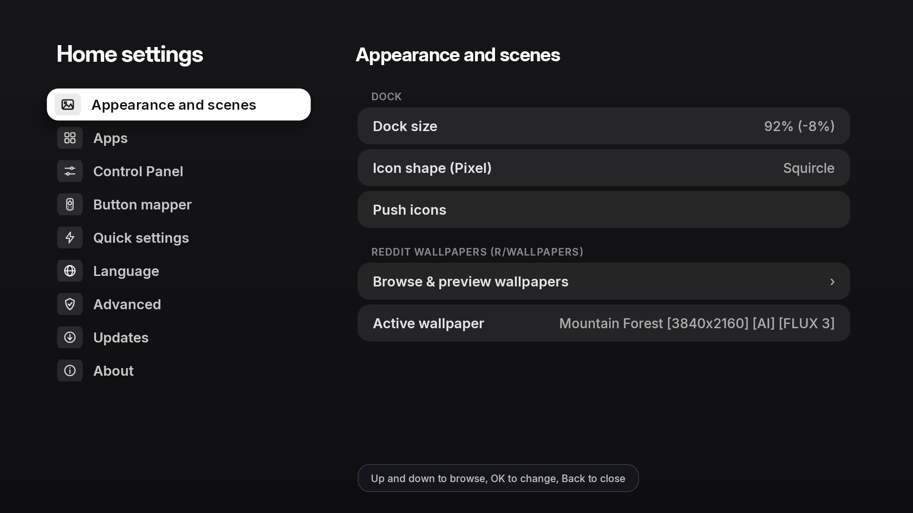

# GlassTV (`v1.0.0`)

> 📦 **Download Latest APK (`v1.0.0`):** **[GitHub Releases (`GlassTV.apk`)](https://github.com/preetstyle/GlassTV/releases/latest)**


**GlassTV** is an ultra-fast, lightweight **Apple tvOS 26 Liquid Glass** home screen and launcher for Android TV & Google TV — built in pure Java with zero third-party runtime dependencies (**~30 MB private RAM / `0.0%` background CPU**).

Designed to stay buttery-smooth on every TV box while bringing a real-time **S-Curve Meniscus Liquid Glass Dock (`50%–150%`)**, a **Top-Right Time + Control Panel Glass Pill**, a **Live 4K UHD `r/wallpapers` Browser**, **One-Click Push Icons (Circular App Icon Pack)**, **Dock App Locking**, **App Icon Changer & Interactive Icon Editor**, a **Universal Liquid Glass Control Panel (`Quick Settings`) overlay**, **Recent Apps Switcher**, **Multi-Tap (`1x / 2x / 3x`) Remote Button Remapping**, and **One-Tap Local ADB Setup**.

---

## ✨ Key Features

- **Apple tvOS 26 S-Curve Meniscus Liquid Glass Dock**
  - True optical meniscus lens refraction along the rounded capsule border with smooth Gaussian-softened center glass, specular rim lighting, and chromatic dispersion.
  - Dynamically scales from **`50%` to `150%`** in *Settings → Appearance and scenes*, with automatic overflow into the **Other apps (`...`)** multi-row glass folder.
- **Clean 4K Wallpaper Canvas + Top-Right Time & Control Panel Glass Pill**
  - Distraction-free 4K wallpaper showcase with no center clock or greeting clutter.
  - Top-right **Time + Control Panel Glass Pill** displays the live clock alongside the Quick Settings icon with smooth focus illumination.
- **Built-in 4K UHD `r/wallpapers` Live Preview Browser**
  - Browse, preview in full-screen 4K UHD (`3840×2160`), and apply curated photography from `r/wallpapers` directly inside *Settings → Appearance and scenes* with instant disk caching.
- **One-Click Push Icons & Lock Dock Apps**
  - **Push Icons**: Apply curated circular TV app icons across your installed apps in a single tap, or hold **OK** on any app to customize its icon individually with the built-in **App Icon Editor**.
  - **Lock Apps in Dock**: Prevent accidental reordering or removal of your favorite dock apps.
- **Universal Liquid Glass Control Panel (`Quick Settings`) Overlay**
  - Accessible from the home screen pill or over **any running app** via the Button Mapper accessibility service with real-time background blur.
  - Includes **Wi-Fi**, **Bluetooth**, **RAM / Recent Apps**, **Do Not Disturb**, **Audio / Sound**, **Sleep Timer**, **Ambient Mode**, **Power / Screen Off**, **Inputs**, **Button Mapper**, **Settings**, and **Search**.
- **Built-In System App & Stock Launcher Manager (`Settings → Advanced`)**
  - Disable stock OEM launchers (*Google TV Home / LauncherX, Android TV Home*, etc.) and manage system bloatware directly over Local ADB (`127.0.0.1:5555`) — no PC required.
- **Multi-Tap Remote Button Mapper (`1x` / `2x` / `3x` Tap) & Easy Local ADB Setup**
  - Assign independent actions for **Single Tap (1x)**, **Double Tap (2x)**, and **Triple Tap (3x)** on any remote button, and grant all required permissions in one click via Local ADB.

---

## 📸 Screenshots

### Home Screen & Liquid Glass Dock

| Autumn Birch 4K & Time + Control Panel Pill | Dolomites 4K & Liquid Glass Dock |
| :---: | :---: |
|  |  |

| S-Curve Meniscus Liquid Glass Refraction (Close-Up) |
| :---: |
|  |

---

### Liquid Glass Control Panel, 4K Wallpaper Browser & Home Settings

| Liquid Glass Control Panel (`Quick Settings`) | 4K UHD `r/wallpapers` Live Preview Browser |
| :---: | :---: |
|  |  |

| Home Settings (`Appearance and scenes`) |
| :---: |
|  |

---

## 🚀 Quick Start (Download & Install)

### Download Pre-Built APK
Download **`GlassTV.apk`** directly from **[GitHub Releases](https://github.com/preetstyle/GlassTV/releases/latest)** and install it on your Android TV / Google TV.

### Build from Source

#### Prerequisites
- **JDK 17+** (`javac`, `jar`)
- **Android SDK** with `build-tools;34.0.0` and `platforms;android-34`

#### Build on macOS / Linux
```sh
./build.sh
# Output APK -> build/GlassTV.apk
```

#### Build on Windows (PowerShell)
```powershell
powershell -ExecutionPolicy Bypass -File .\build.ps1
# Output APK -> build\GlassTV.apk
```

#### Install via ADB
```sh
adb connect <tv-ip>:5555
adb install -r build/GlassTV.apk
adb shell am start -n com.techgenius.tvoslauncher/.MainActivity
```

---

## 📋 Requirements

- **Android TV / Google TV 7.0+ (API 24+)**

---

## 📄 License

Licensed under the **Apache License 2.0** — see [LICENSE](LICENSE) for details.
